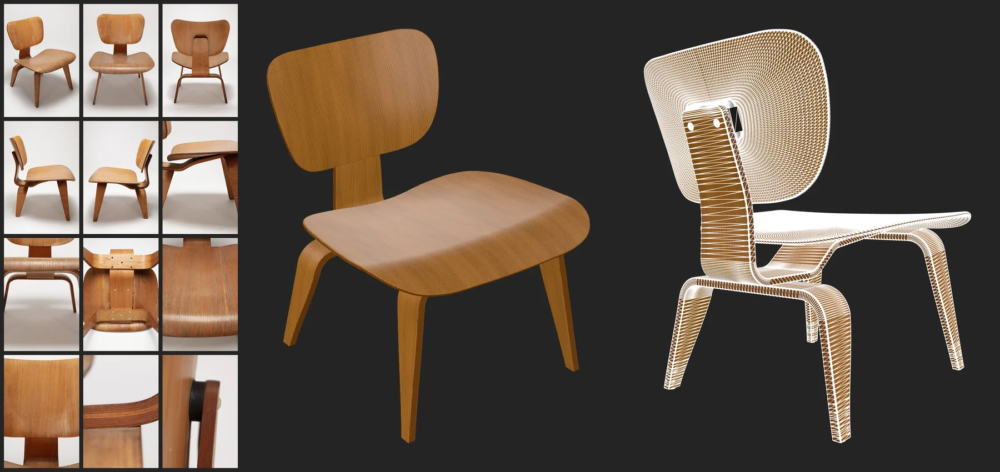

# @moonomat/moon

`moon` lets your AI coding agent build accurate 3D models from photos, drawings or a
description. The agent writes the model in Moon, a YAML language for parametric 3D
models, and `moon` runs it on your computer and writes a standard glTF model.

[](https://moonomat.com/view/?url=https://github.com/moonomat/moon-examples/blob/main/examples/plywood-lounge-chair.moons)

A folder of photos and one prompt, built by Claude Fable 5.2 in 25 minutes.
[Open the model in your browser](https://moonomat.com/view/?url=https://github.com/moonomat/moon-examples/blob/main/examples/plywood-lounge-chair.moons).

## Install

```sh
npm install -g @moonomat/moon
moon login
```

`moon login` opens your browser to sign in with a free Moonomat account, once per
computer. You need Node.js 22.12 or newer, and Google Chrome for `moon render`.

To run without installing, use `npx @moonomat/moon` wherever this page says
`moon`. It starts more slowly. Use it this way too if you have moonrepo, an
unrelated build tool that installs its own `moon` command.

## Build a model with your AI

Put photos, drawings or measurements of an object into a folder. Start your coding
agent next to it and tell it what to build:

```text
Using the moon CLI, create a realistic and detailed 3d model of the chair in ./references/
```

The agent learns Moon from `moon get-started`, writes the model, runs it, compares
renders with your photos and fixes what differs. The chair above took 25 minutes. You get a
`.moon` file with parameters you can change, and a `.glb` that opens in any 3D tool.

Run `moon login` yourself first, the agent cannot sign in for you. For regular use, tell
the agent about `moon` in its instructions file, such as `AGENTS.md`. In Codex, the sandbox
has to allow network access and writes to `~/.cache/moonomat` and `~/.config/moonomat`.

## Write Moon by hand

Save this as `can.moon`:

```yaml
moon: "1.0"
doc: A closed can.
params:
    diameter:
        default: 0.066
        doc: Outer diameter, m.
    height:
        default: 0.122
        doc: Height, m.
render:
    op: Cylinder
    with:
        radiusLow:
            expression: params.diameter / 2
        height:
            param: height
```

Then run it and render an image of the result:

```sh
moon run can.moon
moon render can.moon.glb --multi-view
```

This writes the model to `can.moon.glb` and a 3×3 grid of views to
`can.moon.glb.webp`. Change a number and run it again.

## Commands

| Command | What it does |
|---|---|
| `moon run <file>` | Runs a Moon file and writes its output, usually a `.glb`. Use `-o` to choose where, and `--summary` for a JSON report. |
| `moon render <file>` | Renders a Moon file or glTF model to an image. |
| `moon check <file>` | Finds physical and visual defects in a model. |
| `moon compare <file> --target <reference>` | Scores how closely a model matches a reference model. |
| `moon pack <folder>` | Packs a folder of Moon files and assets into one bundle file. |
| `moon spec <section>` | Prints a section of the Moon reference. |
| `moon get-started` | Prints an introduction to Moon and the index of its reference. |
| `moon login` | Signs in to your Moonomat account. |

`moon <command> --help` lists the options of each command.

## How it works

This package is a small launcher. It downloads the `moon` tool and the Moon
runtime from moonomat.com into `~/.cache/moonomat` and keeps them up to date, so
there is nothing to upgrade. Every download is checked against a signature, using
the public key in `keys/`, and anything that does not match is refused.

Moon files run on your computer. No Moon files, models or file names leave it.
What `moon` sends: [privacy policy](https://moonomat.com/legal/privacy).

## Learn more

- [Moon language reference](https://moonomat.com/docs/moon-spec)
- [Moonomat documentation](https://moonomat.com/docs/)
- [The Moonomat app](https://moonomat.com/edit/), to work on Moon files in the browser

## License

The launcher in this repository is [MIT](LICENSE). The `moon` tool and the Moon
runtime it downloads are proprietary and covered by the
[Moonomat terms](https://moonomat.com/legal/terms).

[Full Moon](https://moonomat.com) is required when a design is used to earn money, in work for a client,
or by a business, while personal projects, open source and evaluation stay free.

Questions and bug reports: [issues](https://github.com/moonomat/moon-cli/issues).
